

<a href="https://flightcoders.com"></a>

 

## About FlightCoders

FlightCoders is a software engineering company. We design and build custom software, AI systems and desktop applications for businesses, and we ship our own products under **Veyra**, our developer-tools brand, and **BaazCyber**, our security brand.

Our software is published on the **Microsoft Store**, the **Visual Studio Code Marketplace**, the **Chrome Web Store**, **Microsoft Edge Add-ons** and **Firefox Add-ons**, and much of it is open source here on GitHub.

## Products

  <a href="https://veyraeditor.com"></a>
  <a href="https://veyraeditor.com/pdf"></a>
  <a href="https://veyraeditor.com/salesforce-studio"></a>
  <a href="https://github.com/fcopensource/baazcyber"></a>
  <a href="https://marketplace.visualstudio.com/publishers/flightcoders"></a>
  <a href="https://github.com/fcopensource/daemon"></a>
  <a href="https://github.com/fcopensource/carrerfitnew"></a>
  <a href="https://flightcoders.com/projects"></a>

**Get our apps**

## What we build for businesses

| Capability | Example work |
| :--- | :--- |
| **AI systems and automation** | Assistants, document intelligence, knowledge retrieval and connected workflows |
| **Custom business software** | Internal platforms, dashboards, APIs, integrations and decision-support tools |
| **Web applications and SaaS** | Product design, MVPs, full-stack development and account workflows |
| **Desktop and developer tools** | Native Windows, macOS and Linux apps, local-first software and editor extensions |
| **Security software** | Malware scanning, code security review and audit-ready reporting |

## How we work

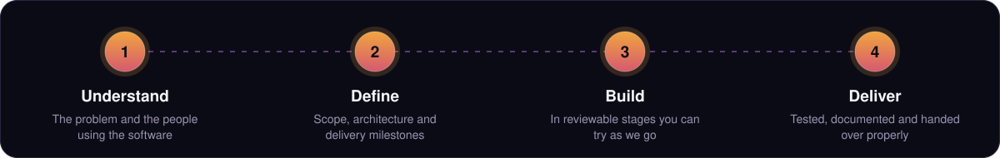

Timelines, payment milestones, ownership and ongoing support are agreed in the project proposal.

## Engineering activity



  
  

<picture>
  <source media="(prefers-color-scheme: dark)" srcset="https://raw.githubusercontent.com/fcopensource/fcopensource/output/snake-dark.svg" />
  <source media="(prefers-color-scheme: light)" srcset="https://raw.githubusercontent.com/fcopensource/fcopensource/output/snake.svg" />
  
</picture>

Refreshed every day from public GitHub data by <a href="./.github/workflows/profile.yml">a GitHub Action</a>.

## Built with

## Work with us

Have an idea, an existing product or a workflow that needs improving? Tell us the problem, who will use the software, the main requirements and your preferred timeline, and we'll suggest the right scope, architecture and next steps.

**Business inquiries: [hire@flightcoders.com](mailto:hire@flightcoders.com)** · [Start a project](https://flightcoders.com/hire-us) · [Our services](https://flightcoders.com/services)

For bugs and contributions, open an issue in the relevant repository. Each repository has its own license and contribution guidelines.

---

**Good software starts with a good conversation.**

© FlightCoders · <a href="https://flightcoders.com">flightcoders.com</a>

