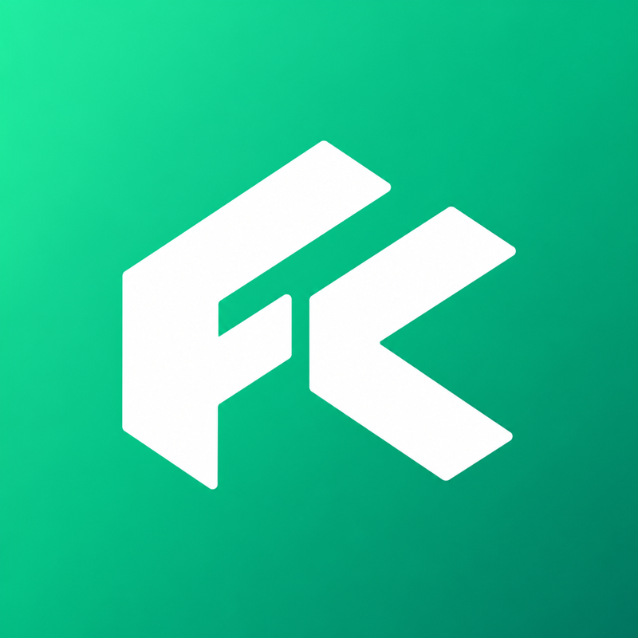
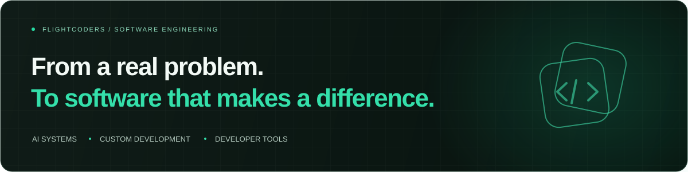

# FlightCoders

### Software that works. Products that matter.

**Custom software · AI systems · Developer tools**

We build software for businesses and create products for the people who build it.

[Website](https://flightcoders.com) &nbsp; / &nbsp; [Our software](https://flightcoders.com/projects) &nbsp; / &nbsp; [Start a project](https://flightcoders.com/hire-us) &nbsp; / &nbsp; [Email us](mailto:hire@flightcoders.com)

## Engineering, with a product mindset

FlightCoders is a software engineering company and the parent company of **Veyra**, our developer-tools business. We bring the same care to client applications that we put into our own software: clear interfaces, useful capabilities, and thoughtful engineering.

Have an idea, an existing product, or a workflow that needs improving? We can discuss the right scope, architecture, and next steps.

**Business inquiries: [hire@flightcoders.com](mailto:hire@flightcoders.com)**

## Our products and projects

| Software | What it does | Explore |
| :--- | :--- | :--- |
| **Veyra Studio** | A local-first AI code editor with Git, a real terminal, and native project access. Built by Veyra, a FlightCoders company. | [veyraeditor.com](https://veyraeditor.com) · [Source](https://github.com/fcopensource/veyraeditor) |
| **Daemon** | A native terminal experience combining a real shell, system telemetry, and a distinctive desktop interface. | [Repository](https://github.com/fcopensource/daemon) |
| **CareerFit** | An AI career platform connecting resume information with job discovery and career workflows. | [Repository](https://github.com/fcopensource/carrerfitnew) |
| **HireLens** | An AI interviewer with resume-aware conversations and local vision coaching. | [Repository](https://github.com/fcopensource/hirelens) |

### Meet Veyra

Our product company builds tools for developers, including **Veyra Studio**, **Veyra PDF**, **Salesforce Studio**, and extensions for Git history, API development, containers, and more.

[Explore Veyra](https://veyraeditor.com) · [VS Code Marketplace](https://marketplace.visualstudio.com/publishers/flightcoders)

## What we build for businesses

| Capability | Example work |
| :--- | :--- |
| **AI systems and automation** | Assistants, document intelligence, knowledge retrieval, and connected workflows |
| **Custom business software** | Internal platforms, dashboards, APIs, integrations, and decision-support tools |
| **Web applications and SaaS** | Product design, MVPs, full-stack development, and account workflows |
| **Desktop and developer tools** | Native applications, local-first experiences, and system integrations |
| **Engineering collaboration** | Discuss the skills, working hours, scope, and support your project needs |

[Explore our services](https://flightcoders.com/services) · [Tell us about your project](https://flightcoders.com/hire-us)

## How we work

**Understand** the problem and the people using the software. **Define** the scope and delivery milestones. **Build** in reviewable stages. **Deliver** with testing, documentation, and an agreed handover.

Timelines, payment milestones, ownership, and ongoing support are discussed in the project proposal.

## Find the code and its history

- **Company website:** [flightcoders](https://github.com/fcopensource/flightcoders) · [Website commits](https://github.com/fcopensource/flightcoders/commits/main/)
- **This GitHub profile:** [fcopensource](https://github.com/fcopensource/fcopensource) · [Profile commits](https://github.com/fcopensource/fcopensource/commits/main/)
- **Terminal project:** [daemon](https://github.com/fcopensource/daemon) · [Daemon commits](https://github.com/fcopensource/daemon/commits/)
- **More work:** [All public repositories](https://github.com/fcopensource?tab=repositories)

Each repository has its own source, history, license, and contribution requirements. Check the relevant README and license before using or contributing to a project.

## Build with FlightCoders

For a project, software evaluation, customization, or engineering collaboration, email **[hire@flightcoders.com](mailto:hire@flightcoders.com)**. Share the problem, intended users, main requirements, and preferred timeline.

For bugs and contributions, open an issue in the relevant repository with the problem and context. Discuss larger changes before starting implementation.

---

**Good software starts with a good conversation.**

[flightcoders.com](https://flightcoders.com) &nbsp; · &nbsp; [hire@flightcoders.com](mailto:hire@flightcoders.com)

