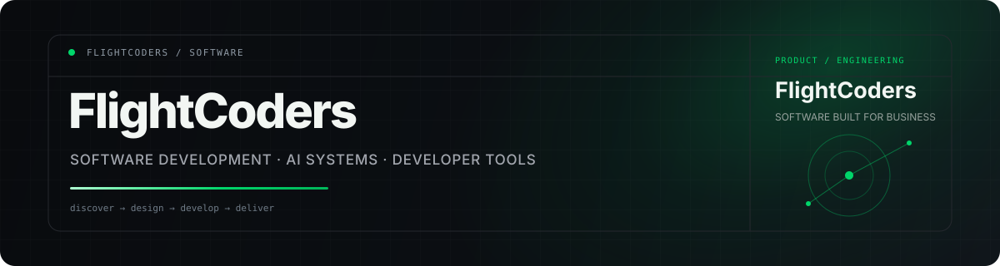
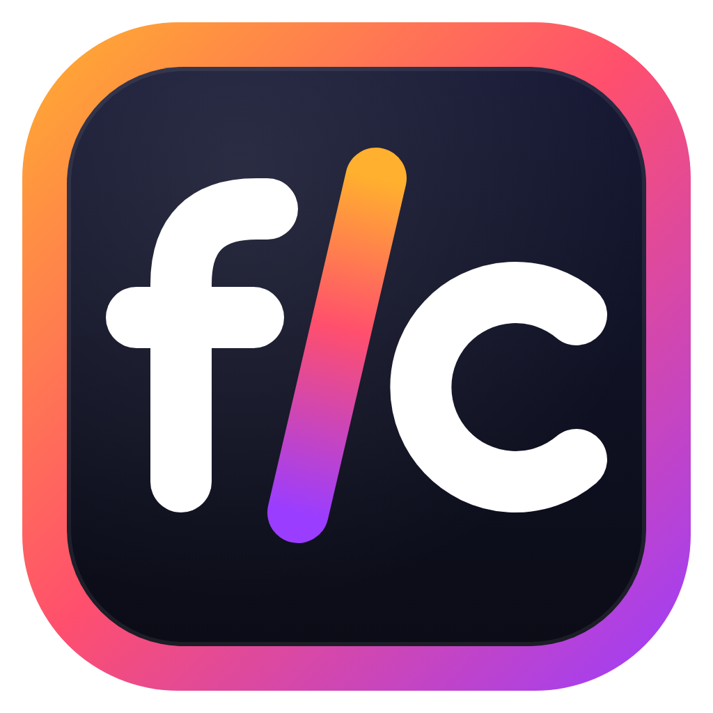

# FlightCoders

**Your vision. Our engineering. Exceptional software.**

We build software products, artificial intelligence systems, and custom applications for businesses.

**[Services](https://flightcoders.com/services) · [Repositories](https://github.com/fcopensource?tab=repositories) · [hire@flightcoders.com](mailto:hire@flightcoders.com)**

---

## Software built around your business

FlightCoders brings product design and engineering together to turn ideas into working software. We work across custom applications, practical AI, business integrations, and developer tools.

| What you need | How we can help |
| :--- | :--- |
| Artificial intelligence systems | AI assistants, knowledge search, document intelligence, and workflow automation |
| Intelligent software systems | Business applications, APIs, integrations, and decision-support tools |
| Web and SaaS products | Product interfaces, dashboards, full-stack applications, and MVP development |
| Desktop and developer tools | Native applications, coding environments, and local-first workflows |
| Engineering support | Discuss developer skills, project requirements, availability, and collaboration |

[Discuss your requirements →](https://flightcoders.com/hire-us)

## Our software

### Veyra Editor

A local-first code editor bringing AI-assisted workflows, Git, and a real terminal into one workspace.

`Rust` `Tauri` `React`

[Explore the repository →](https://github.com/fcopensource/veyraeditor)

### Daemon

A native terminal application combining a real shell with live system telemetry and a distinctive desktop interface.

`Rust` `egui` `Native systems`

[Explore the repository →](https://github.com/fcopensource/daemon)

### CareerFit

An AI career matching platform connecting resume information with job discovery and career workflows.

`Next.js` `Express` `AI`

[Explore the repository →](https://github.com/fcopensource/carrerfitnew)

### HireLens

An AI interviewer with resume-aware conversations and local vision coaching.

`Django` `AI` `Computer vision`

[Explore the repository →](https://github.com/fcopensource/hirelens)

For product evaluation, customization, deployment, or commercial inquiries, contact **[hire@flightcoders.com](mailto:hire@flightcoders.com)**. Licensing and usage terms are defined by each repository and any applicable agreement.

## From requirements to delivery

1. **Discover** — Understand your users, business goals, and technical constraints.
2. **Define** — Agree on scope, architecture, deliverables, timelines, and commercial terms.
3. **Develop** — Build in reviewable stages with working demonstrations and feedback.
4. **Deliver** — Test the product, prepare the handover, and agree on deployment and support.

## Build with FlightCoders

**Need software for your business or engineering support for your team?** Tell us what you want to build, the systems involved, and your preferred timeline.

- **Start a project:** [flightcoders.com/hire-us](https://flightcoders.com/hire-us)
- **Business inquiries:** [hire@flightcoders.com](mailto:hire@flightcoders.com)
- **Explore our work:** [Software projects](https://flightcoders.com/projects)
- **Contribute:** Open an issue in the relevant repository with the problem and context. Discuss larger changes before implementation and follow that repository’s contribution and license terms.

---

### Thoughtful engineering. Useful software.

**SOFTWARE PRODUCTS · CUSTOM DEVELOPMENT · ENGINEERING SUPPORT**

[flightcoders.com](https://flightcoders.com) · [hire@flightcoders.com](mailto:hire@flightcoders.com)

